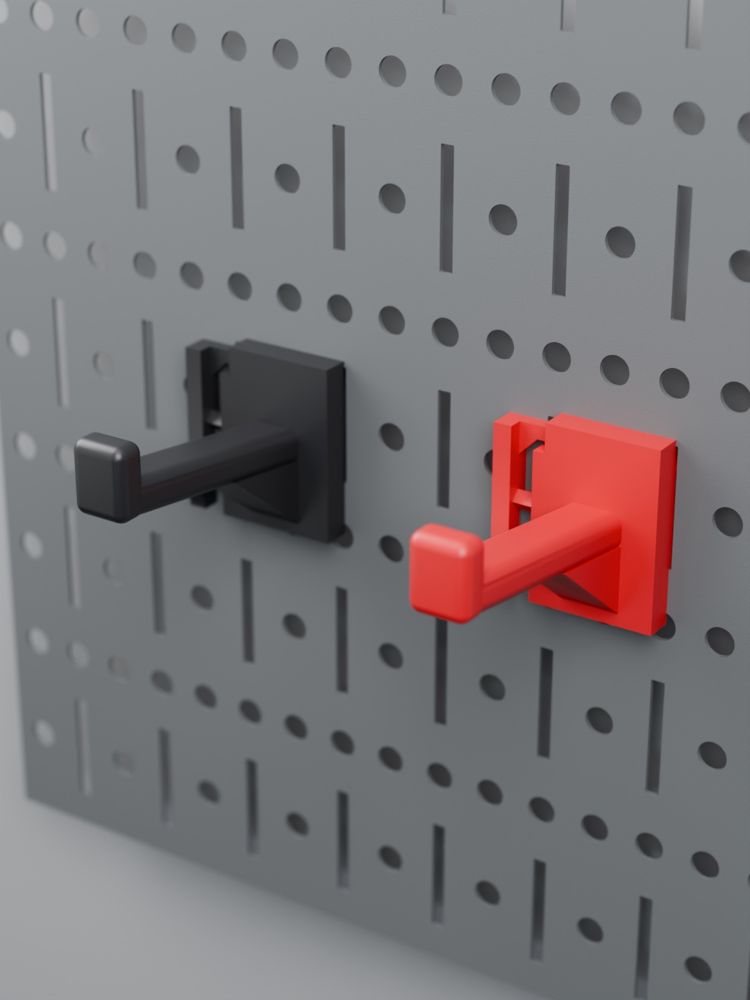
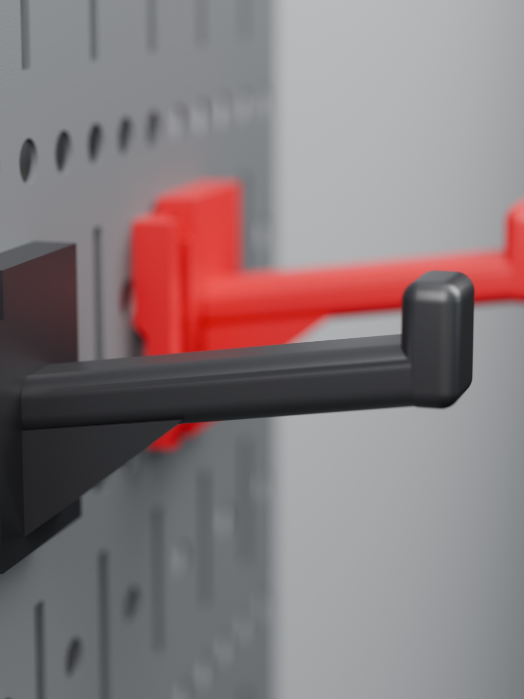

# Wall Control Locking Hook

A strong, plug-and-play hook for **Wall Control slotted steel pegboard**. No screws, no pins: it clips in and locks.

- **Two slots wide, one slot tall.** It hooks two side-by-side slots (1" apart), so it can't twist or rock.
- **Locks in place.** A small barbed nub drops into the top of the slot when you seat the hook, so a bump from below won't
  knock it off.
- **2.5" reach**, with a rounded arm and lip, so nothing sharp catches a strap or handle. About 49 mm of clear hanging space.
- **For 2–4 lb gear:** cable attachments, handles, straps, small tools.
- Sized for **powder-coated** Wall Control panels (about 1 mm steel).

## Download

**[Latest release](https://github.com/Schnibbz/wall-control-hook/releases/latest)**

| File | Use it for |
|---|---|
| `wall-control-hook-X1C-PETG.gcode.3mf` | **Print right away** from Bambu Studio or Handy (X1 / X1C, 0.4 nozzle, PETG, textured plate) |
| `wall-control-hook-PROJECT.3mf` | Bambu Studio project with every setting. Re-slice for another Bambu printer. |
| `wall-control-hook.stl` | Any slicer. It's already in print position (upright). |

## Hang it / take it off

- **On:** tilt the top toward the board, put both claws into two side-by-side slots, swing it flat, and push down until
  the nub clicks.
- **Off:** press the **tab at the bottom of the lever** (the narrow strip on the left edge) toward the board, lift about
  4 mm, and tilt it out.

## Print settings

| | |
|---|---|
| Material | PETG (PETG-CF works too) |
| Orientation | **Upright**, as it hangs. The STL and 3MF are already set this way. |
| Supports | **On**: under the claws and the arm |
| Layers / walls / infill | 0.2 mm · 6 walls · 40 % gyroid |
| Top | Ironing on top surfaces (smooth arm) |
| Bed | Textured PEI, 70 °C |
| Time / filament | About 1 h 08 min · about 21 g |

**After printing:** pick the small support out from under the nub, then check the lever rocks freely.

## Credit

The slot-catch profile comes from the **[DDD Printable Wall Control System](https://github.com/aderusha/DDD-Printable-Wall-Control-System)**
by Allen Derusha (MIT). The two-slot body, the locking lever and the arm are original.

## License

**[CC BY-NC-SA 4.0](https://creativecommons.org/licenses/by-nc-sa/4.0/)**: share and remix with credit, **not for
commercial use**, and remixes must use the same license. The DDD slot-catch profile stays under its MIT license; the
notice is in `LICENSE`.
