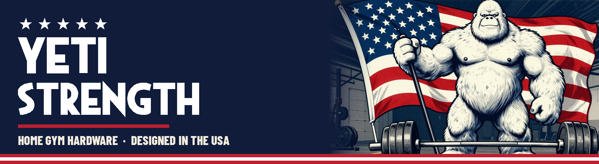
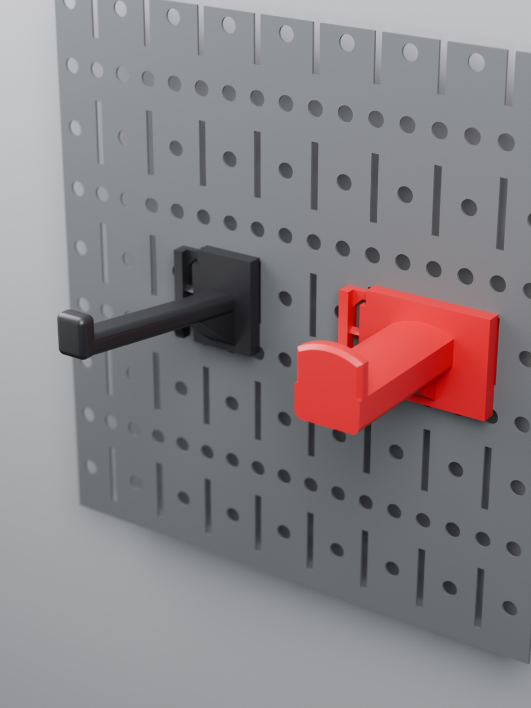

# Wall Control Locking Hooks

Strong, plug-and-play hooks for **Wall Control slotted steel pegboard**. No screws, no pins: they clip in and lock.

- **Hook several slots side by side** (1" apart), so they can't twist or rock.
- **Lock in place.** A small barbed nub drops into the top of the slot when you seat the hook, so a bump from below won't
  knock it off.
- **Rounded arm and lip**, so nothing sharp catches a strap or handle.
- Sized for **powder-coated** Wall Control panels (about 1 mm steel).

## Pick your hook

| Hook | What it's for | Load | Print (X1C, PETG) |
|---|---|---|---|
| **Standard 2.5"** | Cable attachments, handles, straps, small tools. Two slots wide. | 2–4 lb | ~1 h 08 m · ~21 g |
| **Long 3.75"** 🆕 | Same hook with a longer arm, for longer or several attachments. Same 8° rise, lip and lock. | 2–4 lb | ~1 h 20 m · ~22 g |
| **3-Wide Bar Adapter** 🆕 | Anything with a **2" barbell-sleeve hole**: row handles, landmine adapters. Three slots wide. Flat 1"-wide peg with a 1" radius top that matches the 2" bore, and a 1/2" lip that keeps it on. | up to ~10 lb | ~1 h 52 m · ~41 g |

🆕 = new in v1.1. The first prints are on the printer right now. The Standard hook is the one that's been tested on a wall.

## Download

**[Latest release](https://github.com/Schnibbz/wall-control-hook/releases/latest)**, or the files right here:

| Hook | Print right away (Bambu X1 / X1C, 0.4, PETG, textured plate) | Any slicer |
|---|---|---|
| Standard 2.5" | [`wall-control-hook-X1C-PETG.gcode.3mf`](https://github.com/Schnibbz/wall-control-hook/raw/main/wall-control-hook-X1C-PETG.gcode.3mf) · [Bambu project](https://github.com/Schnibbz/wall-control-hook/raw/main/wall-control-hook-PROJECT.3mf) | [`wall-control-hook.stl`](wall-control-hook.stl) |
| Long 3.75" | [`wall-control-hook-3.75in-X1C-PETG.gcode.3mf`](https://github.com/Schnibbz/wall-control-hook/raw/main/wall-control-hook-3.75in-X1C-PETG.gcode.3mf) | [`wall-control-hook-3.75in.stl`](wall-control-hook-3.75in.stl) |
| 3-Wide Bar Adapter | [`wall-control-hook-3wide-bar-adapter-X1C-PETG.gcode.3mf`](https://github.com/Schnibbz/wall-control-hook/raw/main/wall-control-hook-3wide-bar-adapter-X1C-PETG.gcode.3mf) | [`wall-control-hook-3wide-bar-adapter.stl`](wall-control-hook-3wide-bar-adapter.stl) |

The `.gcode.3mf` files are sliced on Bambu's stock X1C presets with every change recorded, so you can also open them in
Bambu Studio and re-slice for another Bambu printer. The STLs are already in print position (upright).

## Hang it / take it off

- **On:** tilt the top toward the board, put all the claws into side-by-side slots, swing it flat, and push down until
  the nub clicks.
- **Off:** press the **tab at the bottom of the lever** (the narrow strip on the left edge) toward the board, lift about
  4 mm, and tilt it out.
- **Bar adapter:** slide the attachment's 2" hole over the peg's lip, then let it drop behind the lip.

## Print settings

| | |
|---|---|
| Material | PETG (PETG-CF works too) |
| Orientation | **Upright**, as it hangs. The files are already set this way. |
| Supports | **On**: under the claws and the arm |
| Layers / walls / infill | 0.2 mm · 6 walls · 40 % gyroid |
| Top | Ironing on top surfaces (smooth arm) |
| Bed | Textured PEI, 70 °C. On a BIQU CryoGrip, use 65 °C. |

**After printing:** pick the small support out from under the nub, then check the lever rocks freely.

## Credit

The slot-catch profile comes from the **[DDD Printable Wall Control System](https://github.com/aderusha/DDD-Printable-Wall-Control-System)**
by Allen Derusha (MIT). The multi-slot bodies, the locking lever, the arms and the bar-adapter peg are original.

## License

**[CC BY-NC-SA 4.0](https://creativecommons.org/licenses/by-nc-sa/4.0/)**: share and remix with credit, **not for
commercial use**, and remixes must use the same license. The DDD slot-catch profile stays under its MIT license; the
notice is in `LICENSE`.

---

<b>YETI STRENGTH</b> · designed by <a href="https://github.com/Schnibbz">Schnibbz</a> · more home gym gear on the <a href="https://github.com/Schnibbz">home page</a>

